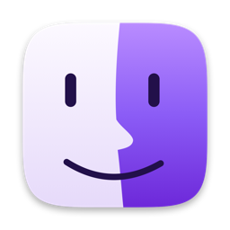
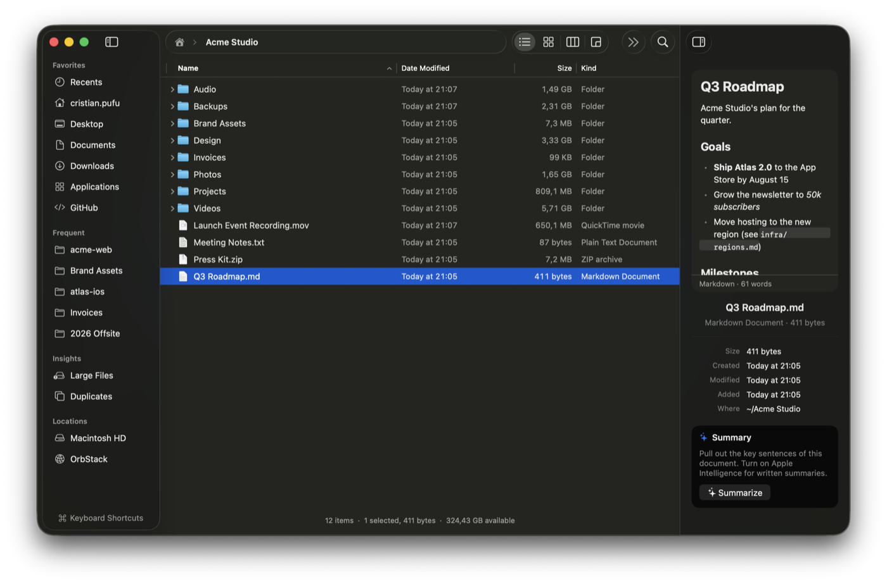
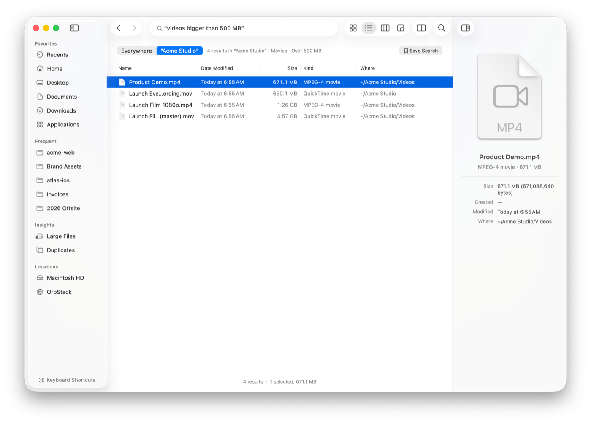
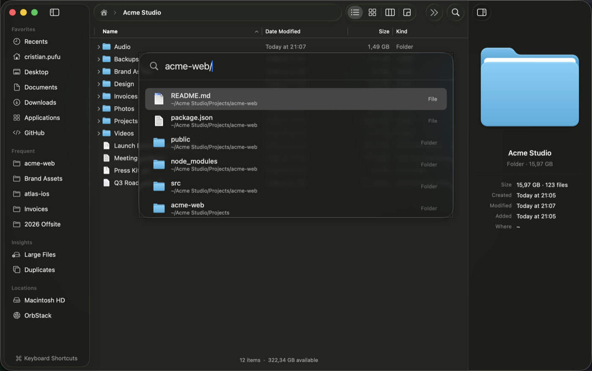
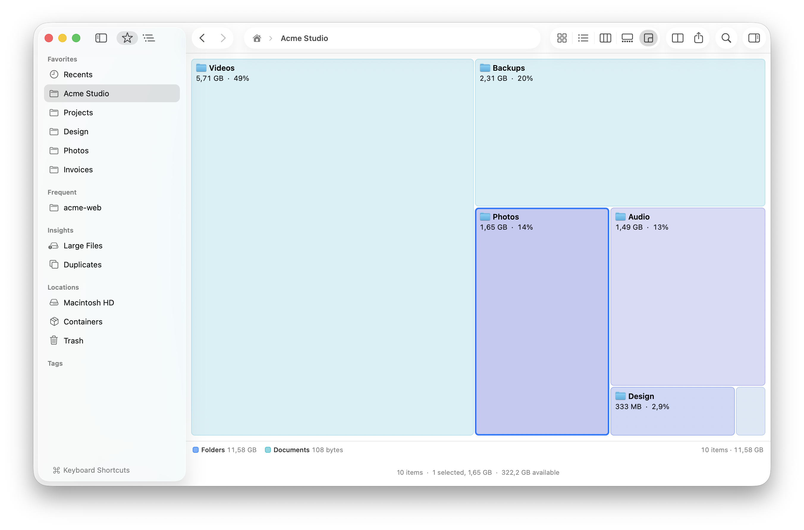
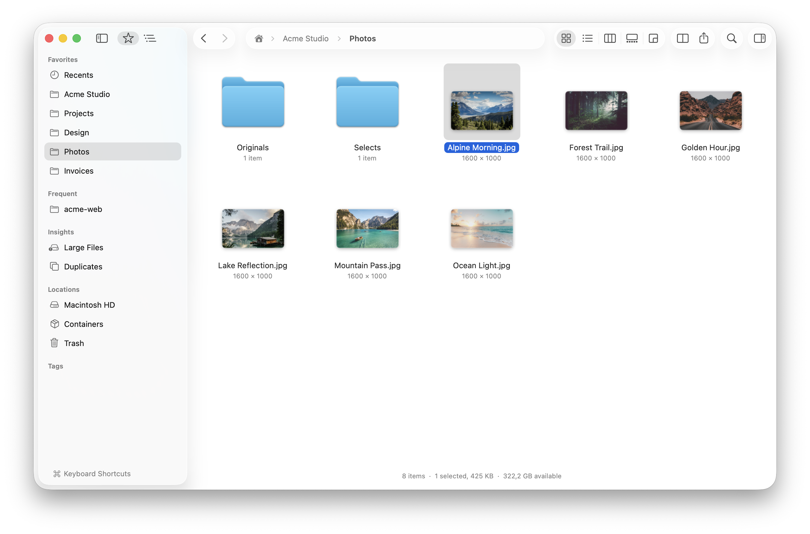
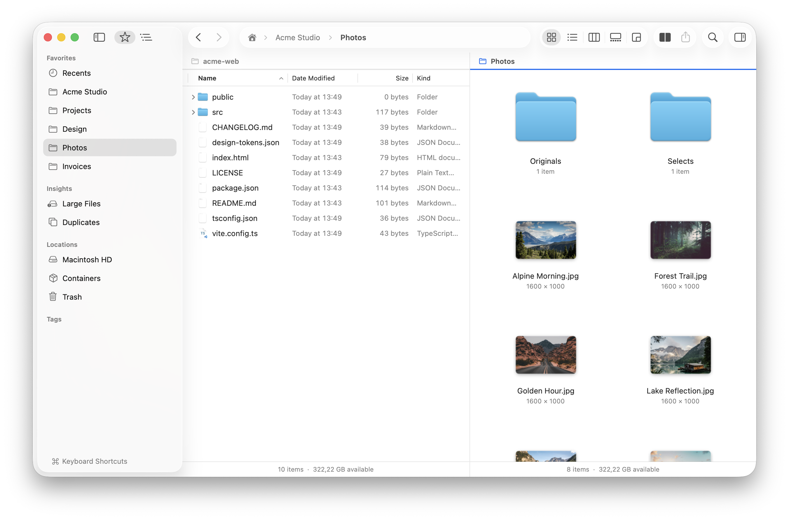
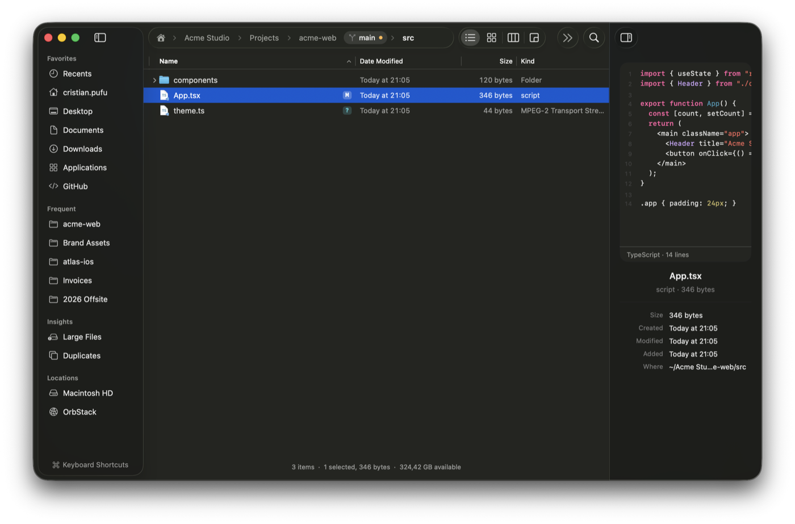
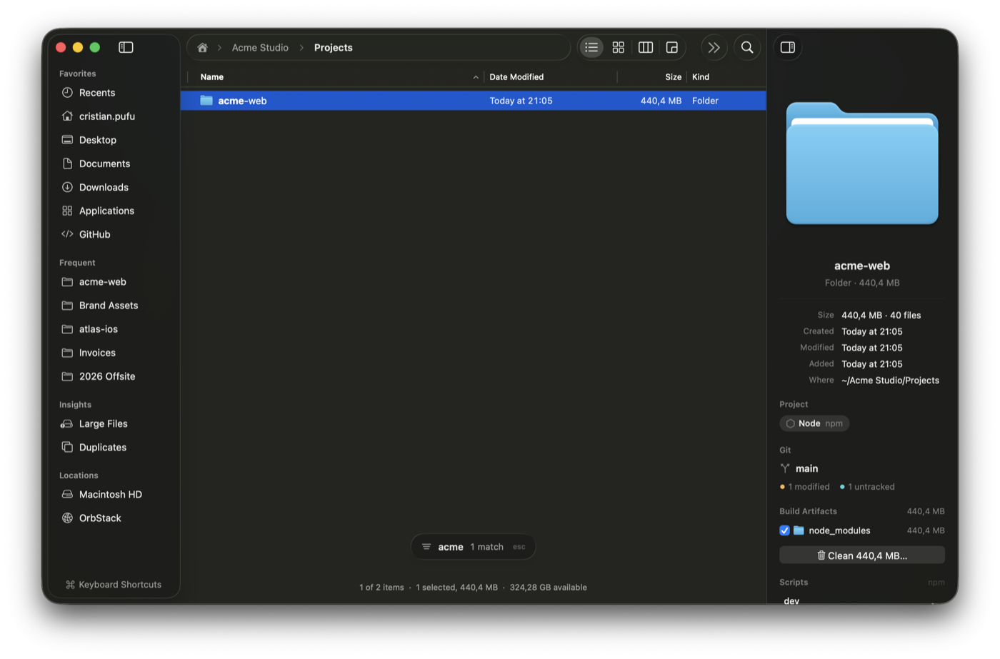
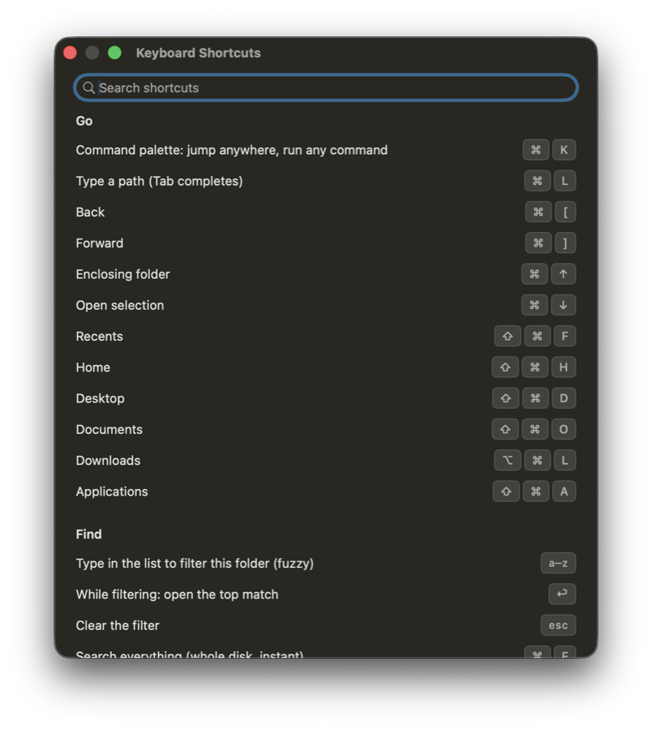

<p align="center">
  
</p>

<h1 align="center">Strata Files</h1>

<p align="center">
  <b>The file manager your Mac deserves.</b><br>
  Find anything in milliseconds, see exactly where your space went, and fly through your files from the keyboard,<br>
  in a native app that feels like it shipped with macOS.
</p>

<p align="center">
  
</p>

---

## Why Strata

Finder is fine until you need to find something, figure out what's eating your disk, or move a few hundred files
without a beachball. Strata keeps everything you already know: the look, the shortcuts, drag and drop, Quick Look,
tabs. Then it adds what you've been missing:

- **Search that keeps up with you.** Every file in your home folder and Applications, searchable as you type.
  Once the index is built, results arrive in milliseconds, even across millions of files.
- **Sizes you can trust.** Folders show their real size the moment you open them, kept current as files change.
- **A keyboard-first workflow.** Jump anywhere with ⌘K, type to filter any folder, and keep your hands off the
  mouse if you like.
- **File operations without fear.** Pause and resume big copies, see conflicts side by side before replacing
  anything, and undo past operations, even after you quit.
- **Made for people who build things.** Git status on every file, project-aware cleanup, Open in Terminal, and
  previews for code, data and archives.

## Find anything, instantly

Type a name, use precise filters, or just say what you mean: *"videos bigger than 500 MB"*,
*"pdfs from last month"*. Strata understands plain English, shows you how it read your search, and answers
before you finish typing. Go further with `regex:` and **Match Case**, or ask Spotlight about what's in the files:
`camera:iphone`, `width:>1920`, `duration:>10m`, *"photos taken with iPhone"*. Save any search to the sidebar and it
stays live as files change.

<p align="center"></p>

## Jump anywhere with ⌘K

One shortcut opens a command palette that knows your most-used folders, the files in your index and Strata's
commands. Type `acme-web/` to list a project's contents without opening a single window.

<p align="center"></p>

## See where your space went

Folder sizes appear the moment you open a folder, without waiting on "Calculating…". Switch to **Disk Usage** to see
your folders as a map, then use **Large Files** and **Duplicates** in the sidebar to reclaim gigabytes in minutes.

<p align="center"></p>

## Five views. Two panes.

Icons, List, Columns, Gallery and Disk Usage, one keystroke apart (⌘1–⌘5, in Finder's order), with ⌘+ and ⌘− for the
text size in List and Columns. Turn on **Dual Pane** to work with two folders side by side, copy or move between them
with a keystroke, or compare and sync them.

<table>
  <tr>
    <td></td>
    <td></td>
  </tr>
</table>

## Made for developers

Strata knows your projects. Every file shows its git status, the current branch sits in the path bar, and the
inspector recognizes Node, Rust, Swift, .NET, Python, Go and more. It lists a project's scripts and frees up the
space taken by build folders like `node_modules` in a click (they go to the Trash, so nothing is lost). Code,
Markdown, JSON, CSV, SQLite databases and archives preview right in the inspector, beautifully.

Containers too. With Docker Desktop, OrbStack, Colima, Podman or Rancher Desktop running, **Containers** in the sidebar
shows your containers as folders. Open one to browse its files like any folder (read-only, read from the container as
you go), copy things out, or open a terminal in it. Start, stop, restart or pause them from the context menu or the
inspector, which also shows a container's image, ports and mounts, and a project's Compose services. A Compose project's
containers come together as a stack: start, stop or restart it at once, and open its project folder in your terminal
or code editor.

Servers too. Connect to Server (⌥⌘K) opens SFTP servers and S3 buckets (Amazon S3, Cloudflare R2, Backblaze B2,
Wasabi, MinIO…) and keeps them under **Servers** in the sidebar. Their folders work like any folder: every view, Quick
Look, copying things out, dropping files in, renaming and deleting, and moves within a server stay on the server. SFTP
goes through your own SSH setup (`~/.ssh/config`, keys, the agent, ProxyJump) and Open in Terminal gives you a shell
there; an S3 secret key stays in your keychain.

<table>
  <tr>
    <td></td>
    <td></td>
  </tr>
</table>

## Everything else you'd expect, done right

| | |
|---|---|
| **Trash** | In the sidebar, like Finder: Put Back (also what Finder trashed), Delete Immediately and Empty Trash, with other disks' Trashes counted. |
| **Archives** | Compress and extract zip, tar, 7z, rar and more, safely: nothing escapes its folder and downloads stay quarantined. Or double-click a zip to browse it like a folder and copy things out. |
| **Tags** | Finder's tags everywhere: colored dots, the color row in the context menu, a tag field in the inspector, a Tags section in the sidebar and `tag:` in search. |
| **Batch rename** | Replace text (or a regular expression), add text, number with a format or change case, previewed live, undone in one step. |
| **Get Info** | Edit comments, the app a file opens with, Locked and permissions right in the inspector. |
| **App updates** | Right-click apps and choose Check for Updates… to see which have a newer version, from their own update feed or the App Store. |
| **Network shares** | Connect to SMB, AFP, NFS and WebDAV shares (⌥⌘K), with macOS's own login and your keychain; SFTP servers and S3 buckets are covered above. |
| **Cloud folders** | See what's only in iCloud Drive or another cloud folder, with Download Now and Remove Download. |
| **Compare and sync** | Compare the two panes' folders and sync them both ways, one way, or as a mirror, verified and undoable. |
| **Your shortcuts, your look** | Change any menu shortcut in Settings, and pick light or dark, row density and the size of file names. |
| **Copy queue** | Big copies run in the background with progress you can pause, resume or cancel. Conflicts are asked up front, with a side-by-side comparison and a diff for text files, and folders can be merged. Turn on **Verify copies** in Settings to check that every byte arrived. Moves between disks keep the original if it changed while copying. |
| **History** | Renames, moves, copies and deletions are recorded. Undo them later, even days later and after a restart, as long as the items are still where they were left. |
| **Recents** | Files you changed in the last 7 days, across your home folder, in one place. |
| **Shelf** | Collect files from anywhere, then drop them all at once. |
| **Your sidebar** | Drag folders into Favorites, reorder them, and eject disks right from the sidebar, or switch it to a tree of every folder. Windows and tabs come back where you left them. |
| **Path bar** | Type a path, `github/acme`, or just a folder's name: matching folders are suggested as you type. |
| **Workspaces** | Save a set of tabs and panes, with their views, and reopen them together from the sidebar, ⌘K or `strata -w`. Folders on network shares and servers connect again. |
| **Ask Strata** | Describe a bulk change ("rename these photos by date taken") and review the plan before anything happens. Runs on your Mac: built-in rules handle common requests, and Apple Intelligence handles the rest. |
| **Summaries** | Get the gist of a PDF or document in the inspector: a short summary written by Apple Intelligence, or the key sentences without it. Nothing ever leaves your Mac. |
| **Command line** | Install it from Settings, then `strata .` opens the current folder and `strata -s "invoice pdf"` searches from your terminal. |

## Keyboard first

Most actions have a shortcut, and most of the ones you know from Finder work the same way. Can't remember one?
Click **Keyboard Shortcuts** at the bottom of the sidebar, or press ⌘/.

<p align="center"></p>

## Private by design

Strata runs entirely on your Mac. The search index, summaries and AI features are local: no accounts, no tracking,
no cloud. Its file index, content index and history are encrypted on disk with a key in your keychain. And a
folder you browse can't run its own code just because you looked at it: Strata switches off the git features a
downloaded repository could use to do that. It only goes online to check for updates (its own, if you allow it, and
other apps' when you ask it to) and to the servers you connect to. Containers' and servers' files are read as you
browse and cleared when Strata quits; SFTP logs in with your own SSH setup, and an S3 secret key stays in your keychain.

## Translations

Strata comes in 21 languages and follows your Mac's (or pick one in Settings ▸ General). Each language is one plain
JSON file in [Localization](Localization): improving a translation or adding a language is a pull request, no Xcode
needed. [Localization/README.md](Localization/README.md) has the four steps.

## Get Strata

Download the latest version from [GitHub Releases](https://github.com/cristipufu/strata-files/releases/latest), open the disk
image and drag Strata to Applications. It needs an Apple silicon Mac running **macOS 26**. Releases are signed and
notarized by Apple, so Strata opens like any other app. It updates itself: **Strata ▸ Check for Updates…**, or
automatically if you allow it (updates are signed and checked before they're installed).

Or build it yourself with the Swift toolchain (Xcode or the Command Line Tools):

```sh
git clone https://github.com/cristipufu/strata-files.git
cd strata-files
scripts/build.sh release --open
```

For the best experience, give Strata **Full Disk Access** in System Settings ▸ Privacy & Security, so it can search
and measure everything without asking folder by folder. Strata walks you through it on first launch.

## Releasing

Push a version tag and the [Release workflow](.github/workflows/release.yml) builds Strata on a Mac, signs it with the
Developer ID certificate, has Apple notarize it, and publishes a GitHub Release with `Strata.dmg`, `Strata.zip`, their
checksums and `appcast.xml`, the signed update feed installed copies check. The release notes come from
`docs/release-notes/<version>.md` when there is one, and the update window shows them too.

```sh
git tag v0.2.0 && git push origin v0.2.0
```

## License

Strata is open source under the [MIT License](LICENSE).

---

<p align="center">
  Found a bug or have an idea? <a href="https://github.com/cristipufu/strata-files/issues">Open an issue</a>.
</p>
